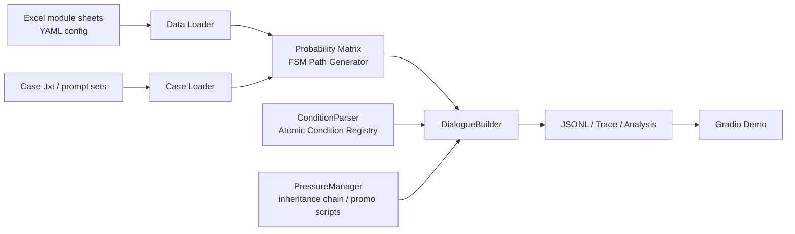
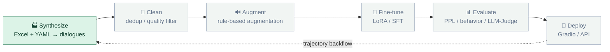
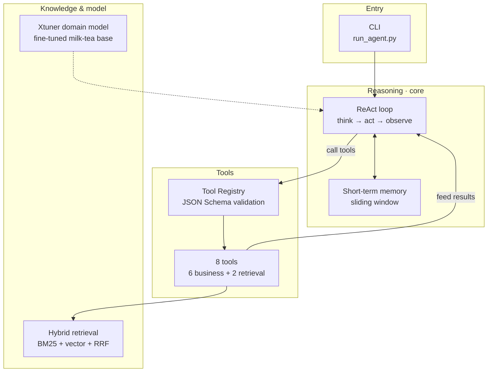

<p align="center">
  
</p>

<h1 align="center">Dialog SFT Forge</h1>

<p align="center">
  <em>Config-driven multi-turn dialogue synthesis · Excel scripts + probabilistic FSM → reproducible SFT samples</em>
</p>

<p align="center">
  <a href="https://huggingface.co/spaces/Soleil-gzm/dialog-sft-forge"></a>
  
  
  
</p>

<p align="center">
  <a href="#quick-start">🚀 Quick Start</a> ·
  <a href="#demo">🧋 Demo</a> ·
  <a href="#data-pipeline">🗺️ Pipeline</a> ·
  <a href="https://github.com/Soleil-gzm/dialog-sft-forge/tree/main/agent">🤖 Agent</a> ·
  <a href="#roadmap">🎯 Roadmap</a> ·
  <a href="#documentation">📚 Docs</a> ·
  <a href="README.md">🌐 简体中文</a>
</p>

## What It Is

Dialog SFT Forge is a config-driven framework for synthesizing multi-turn dialogue data.
It turns Excel script sheets, YAML configs, and case files into reproducible, traceable SFT training samples.

It targets scenarios that need **multi-turn dialogue + business conditions + branching scripts** —
customer service, operations, after-sales, membership callback, and similar domains — letting you
switch business templates and generate large-scale dialogue data without touching the core code.

The repository also ships a milk-tea membership callback **Agent prototype** with a hand-rolled ReAct loop,
tool calling, short-term memory, and configurable knowledge retrieval. Data cleaning/augmentation,
domain fine-tuning, systematic evaluation, and trajectory backflow are planned milestones and should not be
confused with what is already delivered.

## Architecture



## Data Pipeline

The long-term goal is a complete loop of **synthesize → clean → augment → fine-tune → evaluate → deploy**,
so that the synthesized domain data actually drives downstream models and agents:



> Legend: 🟩 green = delivered; ⬜ grey = planned (see [Roadmap](#roadmap)).

## Highlights

- **Config-driven** — modules, transition matrix, terminal and self-loop logic all come from Excel and YAML;
  switching scenarios requires no changes to the main flow.
- **Probabilistic FSM** — module transitions are modeled as a state machine, with `start`, `a_set`, `b_set`,
  `terminal`, and `self_loop` constraining path validity.
- **Condition registry** — numeric comparison, empty-field checks, and `&`-composed conditions; adding a new
  condition type means registering a single handler.
- **Inheritance chain & flexible stop** — `parent` links ancestor/descendant utterances and
  `flexible_stop` produces more natural dialogue pacing.
- **Solid data engineering** — random seeds, single/multi-process, checkpointing, trace logging,
  automatic analysis, and adjacent-dialogue deduplication.
- **Reproducible** — a fixed seed plus unified config output guarantees stable, comparable results.

## Quick Start

### 1) Environment

```bash
git clone https://github.com/Soleil-gzm/dialog-sft-forge.git
cd dialog-sft-forge
python -m venv .venv
python -m pip install -r requirements.txt
# or: pip install -e .
```

Activate the virtual environment (macOS / Linux):

```bash
source .venv/bin/activate
```

Windows PowerShell:

```powershell
.venv\Scripts\Activate.ps1
```

### 2) Generate demo data

```bash
python demo/generate_demo_data.py
```

This produces the demo probability matrix, case files, and script templates. The default scenario is a
milk-tea membership callback.

### 3) Batch-generate dialogues

```bash
python scripts_general/main.py -c demo/config/demo_config.yaml
```

Output goes to `output/<task_name>_<num_dialogues>_<seed>/`, including dialogue JSONL, trace records,
intermediate analysis artifacts, and path caches.

### 4) Launch the demo UI

```bash
python demo/app.py
```

## Demo

The repository ships a Gradio showcase that demonstrates the end-to-end flow with a completely fictional
**"Mingxiang Tea"** membership callback scenario:

```text
Excel scripts + probability matrix  →  FSM path generation  →  dialogue synthesis  →  JSON export
```

UI features:

| Area | Description |
|------|-------------|
| 🔥 Probability heatmap | Color intensity visualizes module transition probabilities |
| 🎛️ Generation controls | Dialogue-count slider (1–20) + random seed; same seed → identical output |
| 🪪 Member profile card | Store / tier / points balance / spend amount / expiry date |
| 💬 Dialogue bubbles | system prompt, customer, and agent roles rendered side by side |
| 🗺️ Paths & export | Module path per dialogue plus one-click structured JSON download |

Run locally:

```bash
python demo/app.py
```

Or try it online: **[🤗 Live Demo on HuggingFace Spaces](https://huggingface.co/spaces/Soleil-gzm/dialog-sft-forge)**

## Example

A typical synthesized dialogue:

```json
{
  "dialogue_id": 1,
  "path": ["start", "welcome", "membership", "follow_up", "terminal"],
  "messages": [
    {"role": "user", "content": "您好，我这边是会员回访，想确认一下优惠活动。"},
    {"role": "assistant", "content": "当然，我们当前有满200减30的活动，您这次消费是否符合条件？"},
    {"role": "user", "content": "我这次买了两杯奶茶，总共 128 元。"},
    {"role": "assistant", "content": "好的，您本次还差 72 元即可参与优惠，是否需要我为您继续办理会员升级？"}
  ]
}
```

This output is ready for SFT dataset construction and can be further piped into cleaning, evaluation,
and training/inference pipelines.

## Agent (M1: hand-rolled ReAct + tool calling)

On top of data synthesis, the project is building the downstream agent capability: an agent that *acts*
on generated domain data rather than merely producing scripts.

### Design

- **Hand-rolled ReAct loop** — no LangChain / LangGraph; think → tool call → observe is fully recorded as a traceable log
- **Tool registry** — tools declare parameters via JSON Schema and export directly to OpenAI `tools` format, with unified arg parsing and error fallback
- **Task-planning toolset** — query member profile / purchase history / inventory, compute the optimal offer, generate callback scripts, record callback results
- **Knowledge retrieval tool (RAG long-term memory)** — retrieve the milk-tea knowledge base (membership policy / points rules / coupons / service) with citations, plus cross-session memory from past callbacks
- **Short-term memory** — multi-turn context with sliding-window truncation

### Architecture



> Legend: solid = implemented; dashed = planned (M4 Xtuner domain model).

### Run

```bash
# macOS / Linux
export AGENT_API_KEY="your-api-key"

# Windows PowerShell
$env:AGENT_API_KEY="your-api-key"

# single-turn task
python agent/run_agent.py --member-id M1001 --task "完成一次积分到期提醒回访"

# multi-turn session (short-term memory persists; type exit to quit)
python agent/run_agent.py --member-id M1001 -i

# contrast demo: disable memory and observe context loss
python agent/run_agent.py --member-id M1001 -i --no-memory
```

The API key can be provided three ways, in priority order: **environment variable > root `.env` > config file**.
LLM endpoint, step limit, tool switches, and the system prompt all live in `agent/config/agent_config.yaml`.
Knowledge retrieval supports BM25 + vector fusion via RRF; with a valid Embedding API it enables hybrid
retrieval, otherwise it degrades to BM25 automatically. Core logic has standalone tests (no LLM or network):

```bash
pytest agent/tests -v
```

<p align="center">
  
</p>

More traces: [points expiry (M1001)](agent/examples/trace_M1001_points_expiry.md) ｜
[out-of-stock detour (M1003)](agent/examples/trace_M1003_out_of_stock.md) ｜
[RAG policy retrieval + cross-session memory (M1001)](agent/examples/trace_M1001_rag_policy.md) ｜
[with vs without memory](agent/examples/memory_compare.md).

## Reproducibility

"Same input + same seed → identical output" is the precondition for an auditable data factory:

- **Unified seed** — `random_seed` drives path sampling, utterance sampling, inheritance chains, and random field generation.
- **Rebuildable data** — `python demo/generate_demo_data.py` regenerates templates, matrix, and cases from a fixed seed; artifacts are committed to the repo.
- **Config as input** — every source of randomness is declared explicitly in [demo/config/demo_config.yaml](demo/config/demo_config.yaml); there is no hidden global state.

## Documentation

- [docs/architecture.md](docs/architecture.md) — layering, module responsibilities, data flow, and current boundaries
- [docs/project-design-doc.md](docs/project-design-doc.md) — goals, scope, technical approach, constraints, evolution
- [docs/progress.md](docs/progress.md) — milestone status, delivered capabilities, limitations, next steps
- [docs/CHANGELOG.md](docs/CHANGELOG.md) — user-facing version history
- [docs/WORKLOG.md](docs/WORKLOG.md) — dated development and maintenance log
- [demo/](demo/) — Gradio demo app and sample-data generator
- [agent/](agent/) — milk-tea membership callback agent (hand-rolled ReAct + tool calling)
- [scripts_general/](scripts_general/) — generation core (paths, conditions, utterances, analysis)
- [requirements.txt](requirements.txt) — Python dependencies
- [pyproject.toml](pyproject.toml) — project metadata and dependencies
- [LICENSE](LICENSE) — MIT license

## Roadmap

- [x] Agent skeleton (M1): hand-rolled ReAct loop + tool registry + task-planning toolset
- [x] Agent long-term memory (M2): hand-rolled BM25 + RRF hybrid retrieval for RAG knowledge and cross-session memory
- [ ] Agent Eval: test set + LLM-as-a-Judge scoring + regression tests
- [ ] Data cleaning: similarity dedup, quality filtering, format normalization
- [ ] SFT training: LoRA / full fine-tuning scripts and configs
- [ ] Evaluation suite: automatic metrics + manual review panel
- [ ] Service deployment: inference API and online endpoint

## License

MIT. See [LICENSE](LICENSE).
