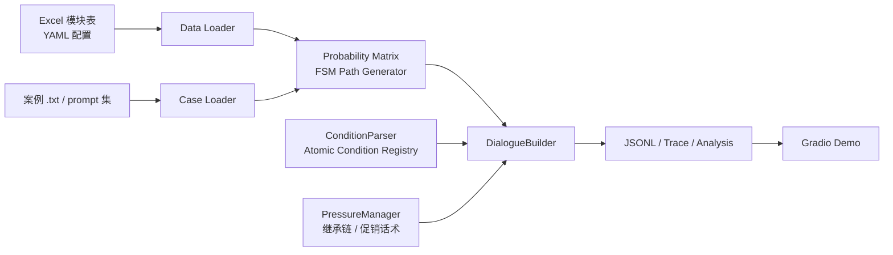
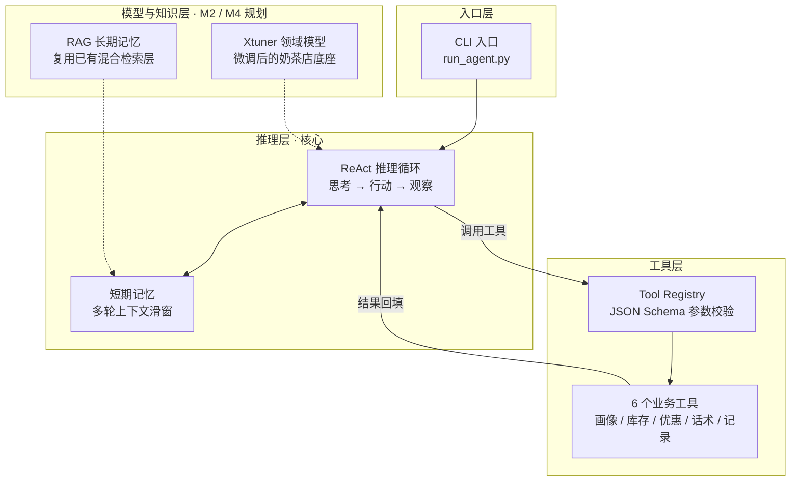
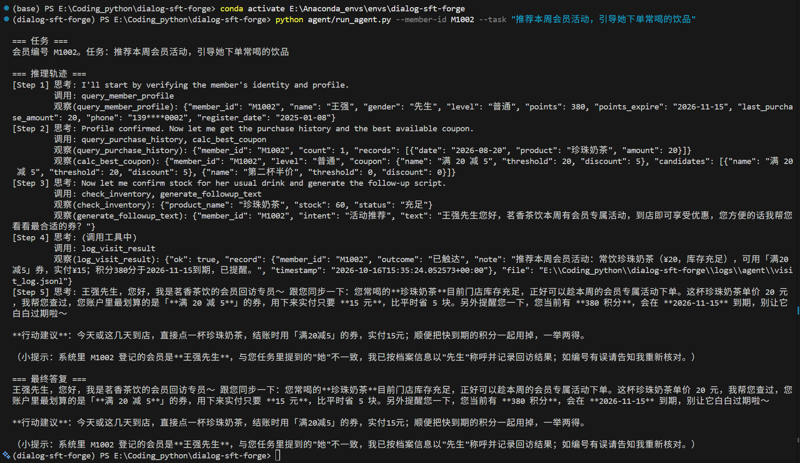

<p align="center">
  
</p>

<h1 align="center">Dialog SFT Forge</h1>

<p align="center">
  
</p>

## 一句话定位

Dialog SFT Forge 是一个以配置驱动为核心的多轮对话数据生成框架，专注于把 Excel 话术表、YAML 配置和案例数据，转换成高质量、可复现、可追踪的 SFT 训练样本。

它适用于客服、运营、售后、会员回访等需要“多轮对话 + 业务条件 + 话术分支”的场景，能够在不改代码的前提下，快速切换不同业务模板和自动生成大规模对话数据。

在此基础上，项目正向数据链路下游延伸，目标打通「数据生成 → 清洗增强 → 微调 → Agent 执行 → RAG 记忆 → 评估 → 轨迹回流」的垂直闭环，让生成的 SFT 数据真正驱动一个可运行的回访 Agent。

## 架构总览



## 亮点特性

- 配置驱动：模块、概率矩阵、终止与回环逻辑全部来自 Excel 和 YAML，换场景无需重写主流程。
- 概率矩阵 FSM：把模块转移视为状态机，用 start、a_set、b_set、terminal 和 self_loop 约束路径合法性。
- 条件注册表：支持数值比较、字段空值判断等原子条件，并允许 `&` 组合条件扩展；新增条件类型只需注册一个处理器。
- 继承链与可变停止：通过 `parent(继承)` 连接祖先/后代链，并结合 `flexible_stop(可选不继承)` 生成更自然的对话节奏。
- 高质量数据工程：支持随机种子、单机/多进程、断点续传、trace 追踪、自动分析与相邻对话去重。
- 可复现：固定随机种子 + 统一配置输出，保证同一输入下生成结果稳定可比。

## 快速开始

### 1) 环境准备

```bash
git clone https://github.com/your-org/dialog-sft-forge.git
cd dialog-sft-forge
python -m venv .venv
source .venv/bin/activate
pip install -r requirements.txt
# 或者：pip install -e .
```

### 2) 生成 demo 数据

```bash
python demo/generate_demo_data.py
```

这一步会生成演示用的概率矩阵、案例数据和模板文件，默认场景是奶茶店会员回访。

### 3) 批量生成多轮对话

```bash
python scripts_general/main.py -c demo/demo_config.yaml
```

生成结果默认写入 `output/<task_name>_<num_dialogues>_<seed>/`，包含：

- 对话 JSONL
- trace 记录
- 中间分析产物
- 路径缓存

### 4) 启动演示页面

```bash
python demo/app.py
```

打开浏览器后，即可看到 Gradio 端到端的对话生成界面。

### 5) 运行回访 Agent（可选）

```bash
export AGENT_API_KEY="your-api-key"
python agent/run_agent.py --member-id M1001 --task "完成一次积分到期提醒回访"
```

Agent 会依次调用会员画像、消费记录、库存、优惠等工具，产出「推理轨迹 + 最终回访话术」。

## 示例

下面是一条典型的合成对话样例：

```json
{
  "dialogue_id": 1,
  "path": ["start", "welcome", "membership", "follow_up", "terminal"],
  "messages": [
    {"role": "user", "content": "您好，我这边是会员回访，想确认一下优惠活动。"},
    {"role": "assistant", "content": "当然，我们当前有满200减30的活动，您这次消费是否符合条件？"},
    {"role": "user", "content": "我这次买了两杯奶茶，总共 128 元。"},
    {"role": "assistant", "content": "好的，您本次还差 72 元即可参与优惠，是否需要我为您继续办理会员升级？"}
  ]
}
```

这种输出适合直接用于 SFT 数据集构建，也可以进一步接入清洗、评测和训推链路。

## Agent 闭环（M1：手搓 ReAct + 工具调用）

在数据生成能力之上，项目正在补齐下游 Agent 能力：让生成的领域数据驱动一个会「做事」的回访 Agent，而不是只会生成话术。

### 设计要点

- **手搓 ReAct 推理循环**：不依赖 LangChain / LangGraph，思考 → 工具调用 → 观察 全流程记录为可追踪 trace
- **工具注册表（Tool Registry）**：工具以 JSON Schema 声明参数，直接导出为 OpenAI `tools` 格式，统一做参数解析与异常兜底
- **任务规划型工具集**：查询会员画像 / 消费记录 / 库存，计算最优优惠，生成回访话术，记录回访结果
- **短期记忆**：多轮上下文滑窗截断（长期记忆将在 M2 接入 RAG）

### 架构



> 图例：实线 = 已实现；虚线 = 规划中（M2 接 RAG 长期记忆 / M4 接 Xtuner 领域模型）。

### 运行

```bash
# macOS / Linux
export AGENT_API_KEY="your-api-key"

# Windows PowerShell
$env:AGENT_API_KEY="your-api-key"

python agent/run_agent.py --member-id M1001 --task "完成一次积分到期提醒回访"
```

API Key 有三种配置方式，优先级：**环境变量 > 仓库根目录 `.env` > 配置文件**。推荐临时会话设置（关掉终端即失效），或复制 `.env.example` 为 `.env` 填写（`.env` 已在 `.gitignore` 中，不会被提交）。端点与模型同理可用 `AGENT_BASE_URL` / `AGENT_MODEL` 覆盖。

LLM 端点、循环步数上限、工具开关与系统 Prompt 均在 `agent/config/agent_config.yaml` 中配置，无需改代码。内核逻辑有独立测试（不依赖 LLM）：

```bash
pytest agent/tests -v
```

### 真实运行效果

下图为普通会员 M1002（王强）的真实运行轨迹：Agent 自主完成 5 步工具编排（画像 → 消费记录 + 最优券 → 库存 + 话术 → 落库），并**自动识别出任务描述中的性别（"她"）与会员档案（先生）不一致**，以档案信息为准称呼、在话术中显式纠偏提示，避免错误信息外发。

<p align="center">
  
</p>

更多场景的完整轨迹：[积分到期提醒（M1001）](agent/examples/trace_M1001_points_expiry.md) ｜ [缺货绕行（M1003）](agent/examples/trace_M1003_out_of_stock.md)。

### 目录结构

```text
agent/
├── core/          # ReAct 循环、工具注册表、LLM 客户端、记忆、配置
├── tools/         # 任务规划型业务工具集
├── config/        # agent_config.yaml
├── data/          # 虚构奶茶店模拟数据
├── examples/      # 真实运行的推理轨迹样例（md 可读版 + json 结构化）
├── tests/         # 不依赖 LLM 的核心逻辑测试
└── run_agent.py   # CLI 入口
```

## 文档导航

- [docs/architecture.md](docs/architecture.md)：分层架构、依赖方向、核心设计说明
- [demo/](demo/)：Gradio 演示应用和示例数据生成脚本
- [agent/](agent/)：奶茶店会员回访 Agent（手搓 ReAct + 工具调用）
- [scripts_general/](scripts_general/)：生成核心代码（路径、条件、话术、分析）
- [requirements.txt](requirements.txt)：Python 依赖声明
- [pyproject.toml](pyproject.toml)：项目元数据与依赖声明
- [LICENSE](LICENSE)：MIT 许可证

## Roadmap

- [x] Agent 骨架（M1）：手搓 ReAct 循环 + 工具注册表 + 任务规划型工具集
- [ ] Agent 长期记忆：复用混合检索引擎接入 RAG
- [ ] Agent Eval：测试集 + LLM-as-a-Judge 自动打分 + 回归测试
- [ ] 数据清洗：相似度去重、质量过滤、格式规整
- [ ] SFT 训练：LoRA / 全量微调脚本与训练配置
- [ ] 评估体系：自动评测 + 人工检查面板
- [ ] 服务化部署：推理 API 与在线接口封装

## License

本项目采用 MIT License。详情见 [LICENSE](LICENSE)。
