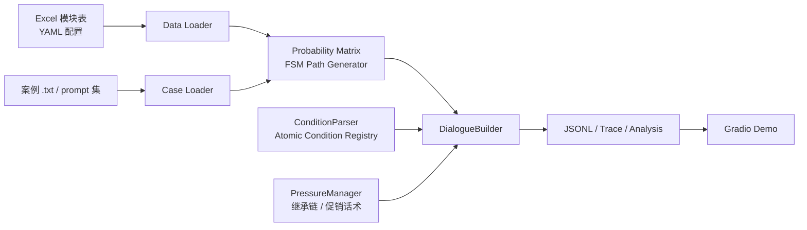

# Dialog SFT Forge

<p align="center">
  
</p>

## 一句话定位

Dialog SFT Forge 是一个以配置驱动为核心的多轮对话数据生成框架，专注于把 Excel 话术表、YAML 配置和案例数据，转换成高质量、可复现、可追踪的 SFT 训练样本。

它适用于客服、运营、售后、会员回访等需要“多轮对话 + 业务条件 + 话术分支”的场景，能够在不改代码的前提下，快速切换不同业务模板和自动生成大规模对话数据。

## Logo / 架构图

### Logo

```text
   ___      _     _     ___  ___  _ _____ ___ ___  _   _
  / _ \____| |   / \   / _ \/ _ \/ /_   _|_ _| __|| | | |
 | | | / _ \ |  / _ \ / /_)/ /_)/ /  | |  | || _| | |_| |
 | |_| |  __/ | / ___ \___/ / ___/ /  | |  | || |_ |  _  |
  \___/ \___|_|/_/   \_\____/_/  /_/   |_| |___|___||_| |_|
```

### 架构总览



## 亮点特性

- 配置驱动：模块、概率矩阵、终止与回环逻辑全部来自 Excel 和 YAML，换场景无需重写主流程。
- 概率矩阵 FSM：把模块转移视为状态机，用 start、a_set、b_set、terminal 和 self_loop 约束路径合法性。
- 条件注册表：支持数值比较、字段空值判断等原子条件，并允许 `&` 组合条件扩展；新增条件类型只需注册一个处理器。
- 继承链与可变停止：通过 `parent(继承)` 连接祖先/后代链，并结合 `flexible_stop(可选不继承)` 生成更自然的对话节奏。
- 高质量数据工程：支持随机种子、单机/多进程、断点续传、trace 追踪、自动分析与相邻对话去重。
- 可复现：固定随机种子 + 统一配置输出，保证同一输入下生成结果稳定可比。

## 快速开始

### 1) 环境准备

```bash
git clone https://github.com/your-org/dialog-sft-forge.git
cd dialog-sft-forge
python -m venv .venv
source .venv/bin/activate
pip install -r requirements.txt
# 或者：pip install -e .
```

### 2) 生成 demo 数据

```bash
python demo/generate_demo_data.py
```

这一步会生成演示用的概率矩阵、案例数据和模板文件，默认场景是奶茶店会员回访。

### 3) 批量生成多轮对话

```bash
python scripts_general/main.py -c demo/demo_config.yaml
```

生成结果默认写入 `output/<task_name>_<num_dialogues>_<seed>/`，包含：

- 对话 JSONL
- trace 记录
- 中间分析产物
- 路径缓存

### 4) 启动演示页面

```bash
python demo/app.py
```

打开浏览器后，即可看到 Gradio 端到端的对话生成界面。

## 示例

下面是一条典型的合成对话样例：

```json
{
  "dialogue_id": 1,
  "path": ["start", "welcome", "membership", "follow_up", "terminal"],
  "messages": [
    {"role": "user", "content": "您好，我这边是会员回访，想确认一下优惠活动。"},
    {"role": "assistant", "content": "当然，我们当前有满200减30的活动，您这次消费是否符合条件？"},
    {"role": "user", "content": "我这次买了两杯奶茶，总共 128 元。"},
    {"role": "assistant", "content": "好的，您本次还差 72 元即可参与优惠，是否需要我为您继续办理会员升级？"}
  ]
}
```

这种输出适合直接用于 SFT 数据集构建，也可以进一步接入清洗、评测和训推链路。

## 文档导航

- [docs/architecture.md](docs/architecture.md)：分层架构、依赖方向、核心设计说明
- [demo/](demo/)：Gradio 演示应用和示例数据生成脚本
- [scripts_general/](scripts_general/)：生成核心代码（路径、条件、话术、分析）
- [requirements.txt](requirements.txt)：Python 依赖声明
- [pyproject.toml](pyproject.toml)：项目元数据与依赖声明
- [LICENSE](LICENSE)：MIT 许可证

## Roadmap

- [ ] 数据清洗：相似度去重、质量过滤、格式规整
- [ ] SFT 训练：LoRA / 全量微调脚本与训练配置
- [ ] 评估体系：自动评测 + 人工检查面板
- [ ] 服务化部署：推理 API 与在线接口封装

## License

本项目采用 MIT License。详情见 [LICENSE](LICENSE)。
