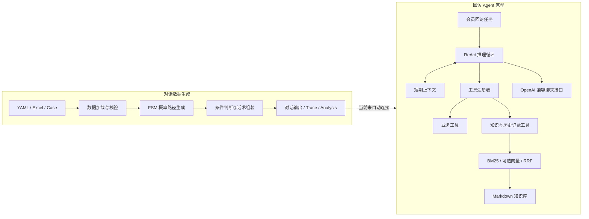

# Dialog SFT Forge 项目设计说明

**文档状态：** 设计基线，持续维护  
**适用范围：** 对话数据生成器与奶茶店会员回访 Agent 原型  
**最后更新：** 2026-10-17

## 1. 项目概述

Dialog SFT Forge 面向需要多轮业务对话训练数据的团队，提供配置驱动的对话合成能力。项目在此基础上包含一个奶茶店会员回访 Agent 原型，用于验证生成数据、工具调用与知识检索在同一业务场景中的衔接方式。

项目由两条当前可独立运行的链路构成：

1. **数据生成链路：** YAML、Excel 话术和案例输入，经状态路径生成、条件判定和话术组装，输出对话数据及可选追踪产物。
2. **Agent 执行链路：** 任务输入经 ReAct 循环编排业务工具与知识工具，输出回访话术，并记录工具轨迹和回访结果。

完整的数据清洗、微调、评测与轨迹回流闭环是演进方向，不是当前仓库已经具备的端到端能力。

## 2. 问题与目标

### 2.1 要解决的问题

- 纯手写脚本难以随业务话术、分支条件和概率策略快速调整。
- 只按模板拼接容易生成结构单一、缺少业务条件约束的对话。
- 对话样本缺少生成决策记录时，覆盖问题和异常路径难以诊断。
- 回访 Agent 若仅依赖模型自由生成，容易编造会员数据或政策信息。

### 2.2 设计目标

- 将业务内容、流程约束与生成逻辑分离，支持以配置和表格扩展场景。
- 通过状态路径、条件注册表、话术继承和促销策略表达对话流程。
- 支持固定随机种子、批量生成、检查点恢复和可选 trace。
- 让 Agent 通过受控工具获取会员、订单、库存、优惠和政策信息。
- 让检索结果携带出处，使知识性回答可追溯。

### 2.3 非目标与边界

- 当前不是通用 Agent 平台，也不提供多租户、鉴权、生产部署和 SLA 能力。
- 当前模拟业务工具使用虚构数据，不可直接连接真实会员系统。
- 当前不包含 Xtuner 训练脚本、领域模型权重、自动评测流水线或轨迹回流任务。
- 当前向量检索使用 NumPy 内存索引，不等同于 FAISS 或分布式向量数据库。

## 3. 用户与主要场景

| 用户 | 主要职责 | 典型操作 |
|---|---|---|
| 业务/运营人员 | 维护话术、条件与场景配置 | 更新 Excel 模板、YAML 和案例 |
| 数据工程/算法人员 | 生成并检查 SFT 样本 | 运行批量任务、检查 trace 与分析输出 |
| Agent 开发人员 | 验证工具编排与知识问答 | 配置兼容 LLM、运行回访任务、查看工具轨迹 |

## 4. 总体设计

## 5. 核心组件设计

### 5.1 对话生成器

- **输入加载：** 从概率矩阵提取模块集合，并加载对应 Excel 工作表、案例和 Prompt。
- **路径生成：** 将模块转移关系表示为概率矩阵，通过 FSM 约束起始、终止、分支集合、自循环和重复策略。
- **条件判断：** 由原子条件处理器和解析器对案例字段求值，支持条件组合和未知条件兜底。
- **话术组装：** 按路径匹配模板，处理占位符、继承链、可选停止和促销插入。
- **任务执行：** 统一单进程/多进程生成流程，按任务配置写入输出、检查点和可选分析结果。

### 5.2 回访 Agent

- **ReAct 循环：** 模型决定调用工具或返回最终答复；循环有最大步数限制。
- **Tool Registry：** 以工具定义和参数 Schema 注册业务工具及知识工具，并统一执行与结果回填。
- **短期记忆：** 在单次任务内按配置保留有限轮次的上下文。
- **业务工具：** 查询虚构会员档案、消费记录和库存，计算优惠，生成话术并记录回访结果。
- **知识工具：** 搜索知识库并召回历史回访日志；知识片段保留来源与章节信息。
- **LLM 接口：** 使用 OpenAI 兼容 Chat Completions 接口；端点、模型和密钥配置与核心编排分离。

### 5.3 检索器

Markdown 知识文件经分块后建立 BM25 索引。若配置了可用 Embedding 服务，则另外建立 NumPy 向量索引，并以 Reciprocal Rank Fusion 合并候选排序；否则使用 BM25 单路。哈希 Embedding 不作为语义检索结果参与融合。

## 6. 数据与接口约定

| 数据 | 主要格式 | 约定 |
|---|---|---|
| 业务配置 | YAML | 路径、生成规模、种子、工具、RAG 参数集中配置 |
| 话术与转移 | Excel | 工作表与模块名对应；概率矩阵决定路径状态集合 |
| 案例与 Prompt | 文本文件 | 案例字段供条件求值和占位符替换；Prompt 提供场景上下文 |
| 生成结果 | JSON/JSONL 等任务产物 | 任务目录隔离；追踪与分析按配置启用 |
| Agent 模拟业务数据 | JSON | 仅用于本地演示和测试 |
| Agent 知识库 | Markdown | 章节文本被分块，检索结果保留文件和章节出处 |
| Agent 回访日志 | JSONL | 每行记录一条结构化回访事件 |

## 7. 质量属性与工程约束

- **可复现：** 生成任务显式设置随机种子；变更输入配置也应视为不同实验条件。
- **可恢复：** 批量生成使用任务输出与检查点降低中断后的重复工作。
- **可观测：** 生成器可输出 trace/分析；Agent 返回推理步骤、工具调用与观察结果。
- **可测试：** 生成器和 Agent 分别有测试目录；核心 Agent/RAG 测试不要求在线 LLM 调用。
- **密钥管理：** API Key 通过环境变量或本地 `.env` 提供，禁止写入代码、示例输出或提交记录。
- **数据保护：** 当前为虚构演示数据。真实业务接入前必须完成授权、脱敏、访问控制和留存策略设计。

## 8. 关键决策与取舍

| 决策 | 理由 | 影响 |
|---|---|---|
| 生成器使用配置和表格描述业务流程 | 业务规则变化不应要求频繁修改核心代码 | 配置与表格需做版本管理和输入校验 |
| Agent 先采用自建 ReAct 与工具注册表 | 保持执行过程透明，便于验证 Agent 基本机制 | 需自行维护协议边界和异常处理 |
| RAG 检索层保持轻依赖、可替换 | 小型演示知识库无需引入重型向量服务 | NumPy 暴力检索适用于小规模语料，不适用于大规模生产检索 |
| Embedding 不可用时退化到 BM25 | 避免无语义哈希向量降低检索排序质量 | 默认运行环境不具备语义召回能力 |

## 9. 演进路线

1. 完善输入校验、输出 Schema 和生成数据质量报告。
2. 为 Agent 建立固定测试集、任务成功率和知识引用质量等自动评测。
3. 依据真实可复现的训练记录补充 Xtuner 数据准备、训练与模型验证流程。
4. 评估将 Agent 轨迹纳入清洗/增强与数据生成的可行性，再决定闭环接口。
5. 只有在知识库规模和并发需求有证据支持后，才替换或扩展向量索引后端。

路线状态详见 [progress.md](progress.md)；系统模块与依赖方向详见 [architecture.md](architecture.md)。